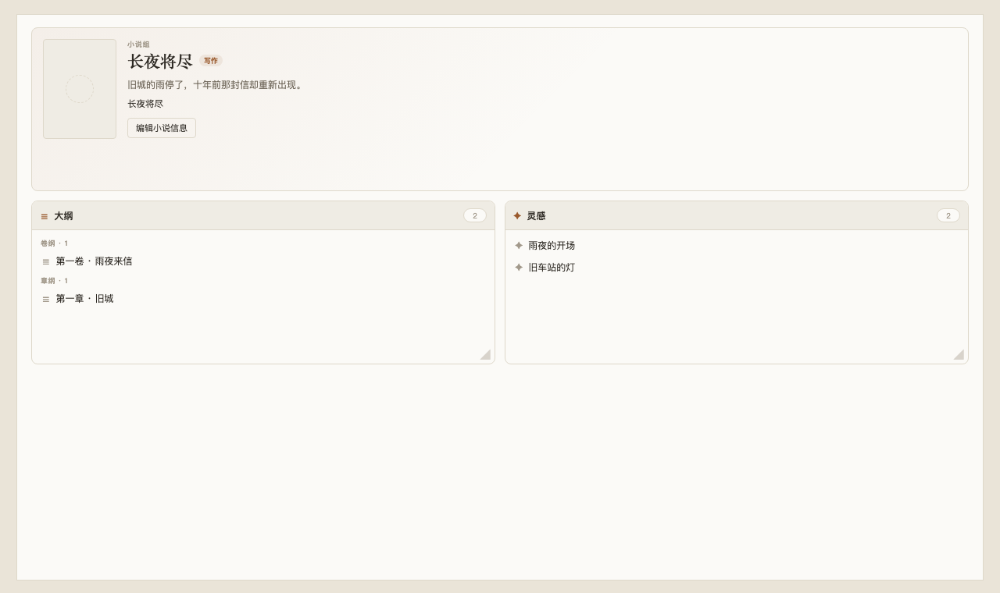
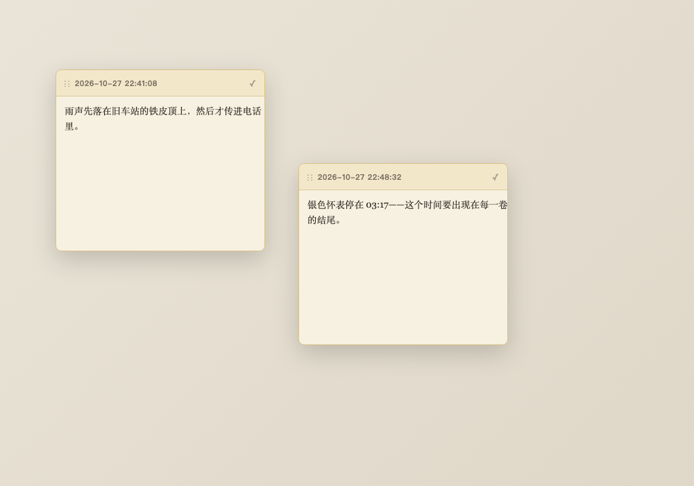

# NovelView

**为 Obsidian 打造的小说写作工作流。**


NovelView 不接管 `.md` 文件，而是在原生 Obsidian Markdown 之上提供小说组、自动小说模式、文章/卷树、专用资料页面、大纲幻灯片、灵感卡片和查找替换。

<p align="center">
  
</p>

> 界面预览使用插件真实 CSS 与组件渲染，并非 Obsidian 实拍截图。

---

## 目录

- [为什么用 NovelView](#为什么用-novelview)
- [核心功能](#核心功能)
- [界面预览](#界面预览)
- [安装](#安装)
- [快速开始](#快速开始)
- [文章列表](#文章列表)
- [工作台](#工作台)
- [特殊页面](#特殊页面)
- [灵感与大纲](#灵感与大纲)
- [小说模式](#小说模式)
- [设置](#设置)
- [开发](#开发)
- [已知限制](#已知限制)
- [作者与许可](#作者与许可)

## 核心功能

| 模块 | 能力 |
| --- | --- |
| 小说组 | 文件夹即小说组；根目录文章自动归入“分散卷” |
| 文章列表 | 卷展开/收起、拖拽、聚焦、行内重命名、新建“无标题”文章 |
| 小说模式 | 小说组普通 Markdown 自动开启，无需按钮或命令 |
| 工作台 | 大纲/灵感卡片，平铺可调大小，关联文章列表当前组 |
| 特殊页面 | 大纲、设定、人物、伏笔、灵感以专用页面展示 |
| 关键词 | 设定/人物等条目标题在正文中分类着色，点击跳转 |
| 灵感 | 最多 8 个浮动便签，标题唯一，保存为卡片并可恢复编辑 |
| 大纲 | 卷纲/章纲，幻灯片分页，支持 `---` 分隔 |
| 查找替换 | 当前目录、正则/全词/大小写、右侧结果面板 |

## 界面预览

| 文章列表 | 特殊页面 |
| --- | --- |
|  |  |

| 灵感便签 | 关键词着色 |
| --- | --- |
|  |  |

## 安装

### 手动安装

1. 下载 [novel-view-0.3.6.zip](dist/novel-view-0.3.6.zip)。
2. 解压到：

```text
<Vault>/.obsidian/plugins/novel-view/
```

3. 在 Obsidian 的 **设置 → 第三方插件** 中启用 **NovelView**。

最低支持 Obsidian **1.6.0**。

### 从源码构建

```bash
# 在项目目录
npm install
npm run build
```

将 `manifest.json`、`main.js`、`styles.css` 放入插件目录。

## 快速开始

1. 在文件列表中右键一个**非根目录**文件夹，选择 **构建小说组**。
2. 点击小说组：左侧打开文章列表，主区域打开工作台。
3. 小说组内的普通 Markdown 自动启用小说模式。
4. 在文章列表右键空白：新建“无标题”文章或“无名卷”；右键文章/卷：重命名、删除、加入大纲。
5. 在小说模式工具栏点击 **有了灵感**，记录内容；关闭后进入工作台“灵感”卡片。

> Vault 根目录不能设置为小说组。

## 文章列表

- **卷**可展开/收起，文章折叠在卷内。
- 根目录文章自动进入虚拟卷 **“分散卷”**。
- **聚焦**：点击文章/卷后高亮；新建文章默认进入聚焦卷。
- **行内重命名**：右键文章/卷 → 重命名，直接在行内输入，Enter 保存，Escape 取消。
- **拖拽**：文章可拖入卷或拖回根目录；卷拖到卷上只调整顺序，不嵌套。
- **新建**：
  - 新建文章直接命名为“无标题”，文件内不重复写 H1；
  - 新建卷直接创建“无名卷”，重名时自动编号。
- **右键菜单**：
  - 空白：新建文章、新建卷；
  - 文章/实际卷：重命名、删除、加入大纲；
  - 分散卷不可重命名、删除、设置卷纲或拖动。

## 工作台

工作台只有两个入口：

1. 点击文件列表中的小说组；
2. 点击文章列表工具栏的 **NovelView 工作台**。

对应小说组由**文章列表当前选中的组**决定，不跟随最近编辑的文章。

### 当前卡片

| 卡片 | 新增 | 内容 |
| --- | --- | --- |
| 大纲 | 否 | 卷纲/章纲，点击条目跳转 |
| 灵感 | 否 | 由“有了灵感”保存的条目 |

- 卡片平铺，可拖动右下角调整占位大小；
- 双击卡片边框直接打开对应文件/特殊页面；
- 人物/设定卡片暂时隐藏，时间线/伏笔工作台 UI 已移除，相关数据文件保留。

### 编辑小说信息

- 只能编辑简介、封面、状态；
- 小说名称始终等于小说组文件夹名；
- 不再提供名称输入或配置文件夹名称。

## 特殊页面

以下 Markdown 文件打开时使用专用页面，而不是普通编辑器：

| 文件 | 页面 |
| --- | --- |
| `大纲.md` | 大纲幻灯片 |
| `设定.md` | 设定卡片 |
| `人物.md` | 人物卡片 |
| `伏笔.md` | 伏笔卡片 |
| `悬浮标签.md` | 灵感卡片 |
| `时间线.md` | 时间线卡片 |

- 设定/人物/伏笔/时间线页面可新增；
- 大纲/灵感不提供新增；
- 条目右键可修改/删除；
- 从文件列表、工作台、关键词或卡片双击打开都会进入特殊页面。

## 灵感与大纲

### 有了灵感

- 小说模式工具栏按钮，最多同时打开 **8 个**便签；
- 默认标题为 `YYYY-MM-DD HH:mm:ss`；
- 右键标题重命名；
- 关闭时保存到小说组的 `悬浮标签.md`；
- 标题必须唯一，重复标题会拒绝保存并保持便签打开；
- 灵感特殊页面以平铺卡片展示；
- 点击卡片恢复该便签的编辑记录，关闭时更新原条目。

### 大纲

`大纲.md`：

```markdown
---
novelview-type: outline
---

# 卷纲

## 第一卷

卷纲内容。

# 章纲

## 第一章

章纲内容。
```

- 文章列表右键实际卷/章节 → 加入大纲；
- 在悬浮卡片中填写梗概；
- 大纲特殊页面使用幻灯片布局，上一页/下一页；
- 正文中的 `---` 分隔线会把同一大纲拆成多张幻灯片；
- 大纲/灵感在工作台无新增按钮。

## 小说模式

小说组内的普通 Markdown **自动启用**小说模式：

- 无“进入小说模式”按钮或命令；
- 小说组外不启用；
- NovelSetting、资料文件、大纲等特殊 Markdown 不启用；
- 编辑/阅读视图均支持；
- 首行缩进、行距、段距、隐藏标记/行号；
- 多级列表及续行不应用首行缩进和额外行距；
- 表格与图片居中显示；
- 列表/引用/Callout 保留原生排版；
- 标题处显示字数与 `novelstate` 状态。

### 浮动工具栏

固定 3 项：

| 操作 | 说明 |
| --- | --- |
| 自动排版 | 删除所有空行（含代码块内空行）、清理行尾空格，保留 frontmatter，可撤销 |
| 加入图片 | 小说组内保存到 `src/`，其他位置使用附件设置 |
| 有了灵感 | 新建浮动灵感便签 |

## 设置

设置页只保留设置项：

- 首行缩进（字符）
- 行距（倍）
- 段距（em）
- 段落划分
- 隐藏 Markdown 格式标记
- 隐藏行号
- 恢复默认设置

## 高级查找 / 替换

- Markdown 标签页工具栏放大镜；
- 工作台工具栏放大镜；
- 命令 **NovelView: 打开高级查找/替换**。

支持区分大小写、全词、正则；结果在右侧面板；替换写入前确认，单次最多 2000 处。

## 开发

需要 Node.js 20+。

```bash
npm install
npm run dev     # esbuild watch
npm run check   # TypeScript strict
npm test        # core tests
npm run build   # production bundle
```

### 项目结构

```text
src/
├── main.ts                  # 插件生命周期、模式、文章列表、工作台、搜索
├── article-list-view.ts     # 文章/卷树、聚焦、行内重命名、拖拽
├── workbench-view.ts        # 大纲/灵感卡片工作台
├── special-page-view.ts     # 特殊页面（含大纲幻灯片、灵感卡片）
├── inspiration-note.ts      # 浮动灵感便签
├── outline-card-modal.ts    # 大纲悬浮编辑卡片
├── src-gallery-view.ts      # src 素材视图
├── editor/                  # CodeMirror 装饰与浮动工具栏
└── core/                    # 段落、格式、关键词、大纲、搜索等
```

更完整的设计说明见 [docs/DESIGN.md](docs/DESIGN.md)。

## 已知限制

- 特殊页面替换 MarkdownView，同标签页内不能直接切回源文件。
- 未关闭的灵感便签只存在内存中，退出 Obsidian 会丢失；最多 8 个。
- 工作台当前只保留大纲/灵感卡片；其他资料模块留待后续版本。
- 工作台卡片大小只保存在当前视图会话。
- 大纲解析/写入可能规范化手工格式。
- “分散卷”是虚拟卷，不能直接转换为真实卷。
- 表格/图片居中依赖 CSS，第三方主题可能覆盖。
- 旧版本按文件夹存放的资料不会自动迁移。

## 作者与许可

作者：**yukisova**

基于 [MIT License](LICENSE) 发布。第三方归属见 [THIRD_PARTY_NOTICES.md](THIRD_PARTY_NOTICES.md)。
