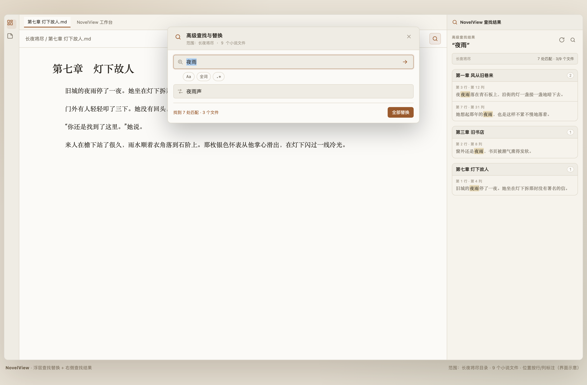
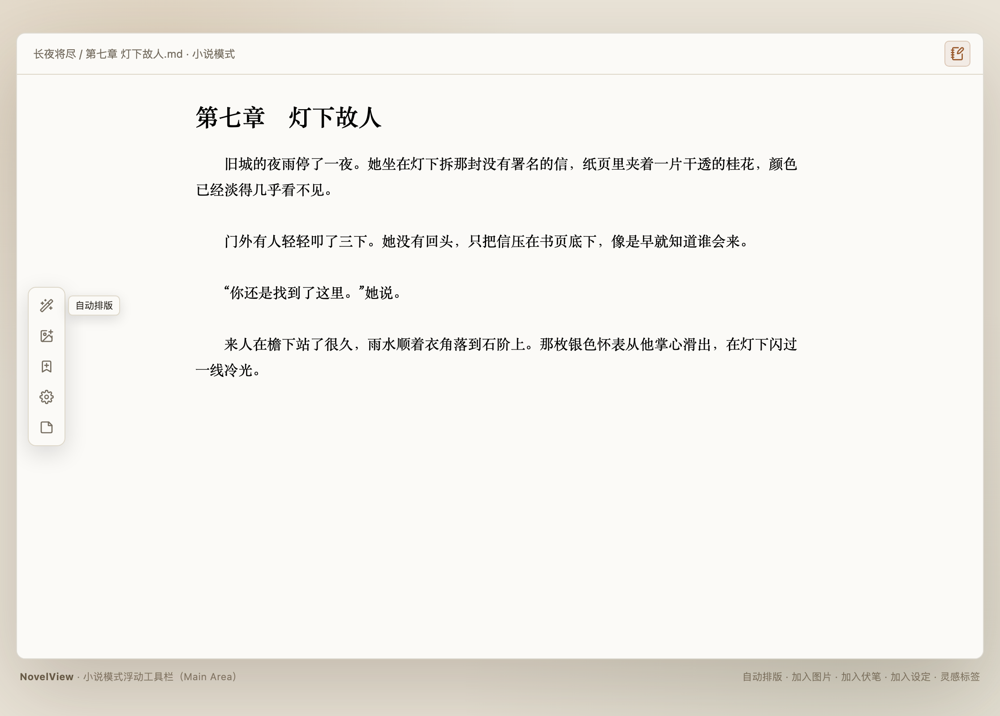

# NovelView 设计说明

## 1. 目标

NovelView 面向在 Obsidian 中用 Markdown 写中文小说的用户。

核心要求：

1. 不接管 `.md` 文件，保留 Obsidian 原生 Markdown 编辑体验。
2. 当前 Markdown 视图可以切换为「小说模式」，随时恢复。
3. 小说模式以可调的首行缩进、行距、段距显示文本。
4. 编辑视图和阅读视图都能进入；两种视图使用不同的入口图标。
5. 光标在新段落/空文档中一开始就位于首行缩进位置。
6. 普通笔记属性（Properties）在小说模式中隐藏；小说组内普通 Markdown 自动模式，设定、人物、时间线、伏笔、悬浮标签、大纲等特殊 Markdown 不进入模式。
7. 提供一个平铺式、可调整卡片占位大小的小说工作台：
   - 大纲卡片（卷纲/章纲，无新增）；
   - 设定卡片；
   - 人物卡片；
   - 时间线卡片；
   - 伏笔卡片；
   - 灵感卡片（无新增）。
8. 小说模式的**排版**不修改正文；浮动工具栏中的自动排版、插入图片、追加扁平资料条目属于显式用户操作，自动排版可撤销，资料条目写入对应分类文件。
9. 工作台在 **Main Area** 的独立标签页中打开，只保留两个入口：点击文件列表中的小说组、点击文章列表工具栏的工作台按钮。
10. 提供高级查找/替换：浮层操作界面、右侧边栏结果列表、工具栏入口，并能跨当前小说目录的全部章节列出匹配位置与执行替换。
11. 编辑视图 + 小说模式时，在 Main Area 显示竖向浮动工具栏：自动排版、加入图片、有了灵感；full/basic 均为这 3 项。
12. 支持文件夹级小说组：右键文件夹创建隐藏的 `NovelSetting.md`；点击小说文件夹不展开，而是把左侧文件列表替换为文章列表。
13. 文章列表顶部提供 NovelView 工作台、链接、回到文件列表、导出；右键仅新建文章/新建卷。
14. 小说组图片统一进入 `src/`，并可从文章列表“链接”在 Main Area 查看。
15. 小说模式显示字数/`novelstate` 状态卡；设定/人物关键词可点击跳转；列表/引用/callout 保持原生排版。
16. 文章列表支持文章/卷拖拽：文章可移入卷，卷只可调整顺序、不能嵌套；卷支持展开/收起。
17. 小说组文件夹在文件列表中显示“小说组”标识，并锁定不可展开；点击后同时打开文章列表与工作台。
18. 资料结构扁平化：设定、人物、时间线、伏笔、悬浮标签各只有一个 Markdown 文件，条目用 h1 分隔。
19. 小说关键词按类型着色，点击后跳到扁平资料文件中对应 h1 的行位置。
20. 工作台卡片平铺 6 列网格，支持右下角调整列/行跨度；内容右键可修改/删除；删除 `novelview-type` 指示文字。
21. 小说组内普通 Markdown 强制启用小说模式且不可切换；NovelSetting、5 个资料文件、大纲等特殊 Markdown 除外。
22. 工具栏新增“有了灵感”，取代 Ribbon 悬浮便签；最多 8 个，日期时间默认标题，右键重命名，关闭保存到 `悬浮标签.md`。
23. 工作台删除文章卡片，新增大纲卡片（卷纲/章纲，无新增）；悬浮标签卡片更名灵感卡片（无新增）。
24. 小说名与文件夹名同步。
25. 文章列表右键章节/卷加入大纲；新建文章不询问标题，默认“无标题”。
26. Vault 根目录不能设置为小说组。
27. 小说模式无手动入口，只对小说组内普通 Markdown 自动开启；多级列表/续行不应用首行缩进。
28. 表格和图片在小说模式中居中。
29. 工作台双击卡片直接打开对应文件/特殊页面，不再预览。
30. 文章/卷右键支持重命名、删除；根目录文章归入“分散卷”，分散卷不可删除/重命名/卷纲。
31. 新建文章文件内不写 H1；特殊 Markdown 打开为专用页面。
32. 文章列表支持聚焦状态与行内重命名；新建文章落在聚焦卷。
33. 工作台只保留大纲/灵感卡片；人物/设定 UI 隐藏，时间线/伏笔工作台 UI 删除；编辑小说信息不再修改名称/文件夹名。
34. 工作台关联文章列表当前组，不跟随最近编辑文章。
35. 灵感页平铺卡片；标题唯一；点击卡片恢复便签。
36. 大纲页幻灯片展示，`---` 分隔幻灯片。
37. 多级列表彻底取消首行缩进/额外行距；表格/图片居中。

## 2. 交互与视觉

### 2.1 自动模式

0.3.5 起不再提供“进入小说模式”按钮或命令：

- `isNovelModeEnabled(view)` 仅由 `isForcedNovelMode(view.file, view)` 决定；
- 小说组内普通 Markdown 自动添加 `.novelview-novel-mode`；
- 小说组外不启用；
- 特殊 Markdown 不启用；
- 编辑/阅读视图都会被 `syncView()` 同步；
- 没有 `viewActions`、`novelModeFiles` 或手动切换状态；
- 命令仅保留高级查找（1 个）。


### 2.2 小说模式同时支持编辑和阅读

编辑视图：

- 作用于 `.markdown-source-view.mod-cm6 .cm-line`；
- 使用 CodeMirror 行装饰识别正文/空行；
- 隐藏 Markdown 格式标记、行号；
- 隐藏笔记属性区域；
- 编辑视图 + 小说模式时显示浮动工具栏（见 2.5）。

阅读视图：

- 作用于 `.markdown-preview-view` 的渲染段落 `<p>`；
- 首行缩进、行距、段距通过普通 CSS 实现；
- Markdown 已经渲染，因此不需要隐藏标记；
- 同样隐藏 Properties 区域；
- 阅读视图的图标和文案与编辑视图不同。

### 2.3 设置页

设置页包含：

- 首行缩进（0–8 字符）；
- 行距（1.2–2.4 倍）；
- 段距（0–2 em）；
- 段落划分：按换行 / 按空行；
- 隐藏 Markdown 格式标记；
- 隐藏行号；
- 工作台与卡片说明；
- 工作台/灵感功能说明；
- 高级查找/替换的范围、选项与结果位置说明；
- 普通 Properties 隐藏、资料笔记拦截、小说组构建的说明。

设置页的预览使用与正文一致的 CSS 变量实时更新。修改会立即应用到所有打开的小说模式视图。

### 2.4 高级查找/替换的界面分区

高级查找由两个分离的界面组成：

- **浮层**：位于 Main Area 上方、无背景遮罩的固定面板。包含查找、替换输入框，大小写/全词/正则选项，以及“全部替换”按钮。用户可以一边操作浮层，一边查看右侧结果或编辑正文。
- **右侧结果视图**：注册为独立 `ItemView`，首次打开时放入右侧边栏。按文件分组列出匹配，展示行号、列号和上下文；点击某条结果会打开对应文件并定位。

入口按钮放在 Markdown 标签页的工具栏，并同步提供工作台工具栏入口和命令入口。工作台本身在 Main Area，查找结果在右侧边栏，两者不争用同一区域。



### 2.5 小说模式浮动工具栏

工具栏只在 `isNovelModeEnabled(view) && view.getMode() !== "preview"` 时出现，DOM 挂载在 MarkdownView 的 `containerEl` 内，位置绝对定位在 Main Area 编辑器左侧，竖向排列。切换阅读/编辑或退出模式时，`syncView()` 会创建或销毁工具栏。

可见按钮取决于文件位置：

| 文件位置 | 范围 | 按钮 |
| --- | --- | --- |
| 小说组根目录正文 | `full` | 自动排版、加入图片、有了灵感 |
| 小说组子文件夹正文 | `basic` | 自动排版、加入图片、有了灵感 |
| 非小说组文件 | `basic` | 自动排版、加入图片、有了灵感 |

按钮：

| 按钮 | 实现 |
| --- | --- |
| 自动排版 | 删除所有空行、清理行尾空格；保留 frontmatter |
| 加入图片 | 小说组内保存到 `<组>/src/`；非小说组使用附件设置；光标插入 `![[...]]` |
| 有了灵感 | 新建最多 8 个浮动灵感便签之一；关闭时保存到小说组 `悬浮标签.md` |

自动排版规则：

- 删除所有空行，包括代码块内部的空行；
- 保留 YAML frontmatter 原样；
- 清理正文行尾空格；不修改标点/缩进/剧情文字。



### 2.6 文件夹小说组

右键文件夹时，`workspace.on("file-menu")` 增加“构建小说组”菜单项。执行后：

- 仅允许非根目录文件夹；Vault 根目录不显示“构建小说组”，已有根目录 NovelSetting 忽略；
- 在文件夹内创建 `NovelSetting.md`；
- 内容是：

```yaml
---
novelview-type: novel-setting
novel-name: "文件夹名"
novel-description: ""
novel-cover: ""
---
```

- 工作台读取并展示这些字段；
- **编辑小说信息** 打开 Modal，仅可修改简介、封面、状态；名称由文件夹名决定，不提供配置文件夹名称；
- NovelSetting 文件在文件列表中被 CSS 隐藏（`.nav-file[data-path$="/NovelSetting.md"]`）；
- 大纲/资料卡片、搜索范围和文章列表都会排除 NovelSetting。

文件夹点击与标识：

- 在 document 捕获阶段监听 `.nav-folder-title`；
- 如果 `data-path` 对应文件夹内存在 NovelSetting，则阻止默认行为，包括折叠箭头；小说组文件夹在列表中不可展开；
- `.nav-folder` 和标题加 `novelview-novel-folder`/`novelview-novel-folder-title`，显示“小说组”徽标，并用 CSS 隐藏 `.nav-folder-children`；
- 点击后把左侧 `file-explorer` leaf 替换为文章列表，同时在 Main Area 打开工作台；
- 左 Ribbon、命令、设置页都不再提供工作台/便签入口；
- 文章列表通过 `leaf.setViewState({ type: "file-explorer" })` 恢复文件列表。

扁平资料文件：

- 小说组根目录下每类资料只有一个 Markdown 文件：`设定.md`、`人物.md`、`时间线.md`、`伏笔.md`、`悬浮标签.md`，另有 `大纲.md`；
- 每个资料条目以 h1 分隔，h1 标题自动作为关键词；
- 标题下可选 `关键词：` 行补充别名；
- 大纲以 `# 卷纲` / `# 章纲` 两个 h1 层级和 h2 条目组织；
- 文件由 frontmatter `novelview-type` 标记，不能进入小说模式，也会被文章列表/搜索/导出排除；
- 小说组内其余普通 Markdown 强制启用小说模式；
- 旧版按文件夹存放的资料不自动迁移。

文章列表顶部工具栏：

- NovelView 工作台；
- 链接：在 Main Area 打开 `src/` 素材视图；
- 回到文件列表；
- 导出：合并正文到 `<组>/导出/`。

文章树与拖拽：

- 卷可展开/收起，文章折叠在卷内；
- 文章可拖入卷或拖回根目录；
- 卷拖到卷上只调整顺序，不移动文件夹，因此不会嵌套；
- 新建卷只创建在根目录，直接生成“无名卷”，无输入框；重名自动编号；
- 空白右键菜单只有“新建文章”和“新建卷”。


## 3. 首行缩进与光标的修复

问题：使用 CSS `text-indent` 时，空行没有内联文本，浏览器的光标只会在有文字后才进入缩进位置。结果是按 Enter 新建段落或打开空笔记时，光标先显示在顶格，输入后才跳到缩进位置。

解决方案：

1. 段落正文继续使用 `text-indent: var(--indent)`。它只缩进一个块的首个可视行，自动折行的续行保持顶格。
2. CodeMirror 扩展给**空行**添加 `.novelview-empty-line`。
3. 小说模式下，空行使用：

```css
.cm-line.novelview-empty-line {
  padding-inline-start: var(--novelview-first-line-indent);
}
```

padding 会移动行容器的内联内容起点，因此空行上的光标也在缩进位置；输入文字后这个类会变成正文行类，padding 换成 `text-indent`，视觉位置保持一致。

4. 完全空文档在初始测量前可能没有可见区间，扩展对 `doc.length === 0` 做特殊处理，强制给第一行添加空行装饰。

无头 Chromium 实测（16px 字号、2em 缩进）：

```json
{
  "classes": "cm-line novelview-empty-line",
  "paddingInlineStart": "32px",
  "lineLeft": 49,
  "caretLeft": 81,
  "caretOffset": 32
}
```

### 已有手工缩进

如果一行已经以空白字符开头，会添加 `.novelview-preindented`，并将显示缩进置 0，避免与原来的全角空格叠加。

## 4. 属性与资料笔记

### 4.1 普通 Properties

普通 frontmatter 不再阻止小说模式。进入后，正文上方仍保留属性数据，但显示层隐藏：

```css
.novelview-novel-mode .metadata-container,
.novelview-novel-mode .markdown-preview-view .metadata-container,
.novelview-novel-mode .markdown-source-view .metadata-container,
.novelview-novel-mode .frontmatter,
.novelview-novel-mode .cm-line.HyperMD-frontmatter {
  display: none !important;
}
```

属性仍保留在文件中；退出模式即可看到，自动排版也会保留 frontmatter。

### 4.2 资料笔记拦截

以下 `novelview-type` 分类属于资料笔记，不能进入小说模式：

| 分类 | 值 |
| --- | --- |
| 设定 | `setting` / `worldbuilding` / `设定` / `世界观` |
| 人物 | `character` / `person` / `人物` / `角色` |
| 时间线 | `timeline` / `时间线` / `年表` |
| 伏笔 | `foreshadowing` / `clue` / `伏笔` / `线索` |
| 悬浮标签 | `inspiration` / `idea` / 灵感 / 灵感便签 / 悬浮标签 |

实现同时检查当前编辑器的实时 frontmatter（`parseYaml`）和 `metadataCache`，取并集。只要识别出任意分类，就显示 Notice：

> NovelView：设定、人物、时间线、伏笔和悬浮标签属于资料笔记，不能进入小说模式。

NovelSetting 文件按文件名额外拦截，并提示由工作台管理。

### 4.3 阅读视图

阅读视图同样应用属性隐藏 CSS；资料笔记拦截规则与编辑视图一致。

### 4.4 与章节/搜索的关系

`hasReferenceProperty()` 用于从大纲/资料卡片、文章列表和高级查找范围中排除**任意带 `novelview-type` 属性**的文件。因此：

- 资料笔记不会出现在章节列表；
- NovelSetting 也不会出现在章节或搜索结果；
- 人物、设定、时间线、伏笔资料可以出现在对应工作台卡片；
- 普通属性章节仍可以被检索。

### 4.5 模式状态

资料笔记拦截只发生在尝试进入模式时；普通属性进入模式后再添加资料属性不会自动退出，只有下次切换时才检查。小说模式状态仍按文件保存在当前会话。

### 4.6 字数与状态卡

小说模式在 `containerEl` 右上角添加 `.novelview-article-status`：

- `countNovelCharacters()` 去掉 frontmatter 后统计非空白字符；
- 状态优先读取当前文章 frontmatter 的 `novelstate`，否则读取所属小说组 NovelSetting 的 `novelstate`，默认 writing；
- 每 800ms 更新一次，并在模式切换时立即创建/销毁；
- 卡片在小说组中可点击，打开 NovelSetting 编辑 Modal；
- NovelSetting 编辑 Modal 增加状态下拉，写回 `novelstate`。

支持值：写作/writing、修改/revising/editing、完稿/finished/done。

### 4.7 分类关键词与精确跳转

扁平资料文件中的每个 h1 条目自动成为关键词；标题下可选一行 `关键词：`/`Keywords:` 补充别名：

```markdown
# 沈砚
关键词：小沈、沈先生
```

索引范围：当前活动章节所属小说组的 5 个资料文件——`设定.md`、`人物.md`、`时间线.md`、`伏笔.md`、`悬浮标签.md`。

`KeywordEntry` 带：

- `category`：setting / character / timeline / foreshadowing / inspiration；
- `line`：条目 h1 的行号；
- `heading`：条目标题。

编辑视图：

- `keyword-extension.ts` 使用 `Decoration.mark` 添加 `.novelview-keyword-link` 和 `novelview-keyword-${category}`；
- 同时写 `data-novelview-path`、`data-novelview-line`、`data-novelview-category`；
- 模式切换/资料变更时通过空 dispatch 重建。

阅读视图：

- `registerMarkdownPostProcessor` 调用 `linkKeywordsInElement()`；
- 生成同样分类 class、目标行号和分类属性；
- 跳过 `<a>`、`<code>`、`<pre>`、属性区。

点击：

- 捕获阶段读取关键词的 path/line；
- `openFileAtLine()` 打开资料文件，把光标/滚动定位到 h1 标题行。

颜色：

- 设定橙、人物紫、时间线蓝、伏笔红、悬浮标签绿，由 CSS 分类 class 提供。


### 4.8 强制小说模式

- `isSpecialNovelFile(file)`：NovelSetting、5 个资料文件名、`大纲.md`、任意带 `novelview-type` 属性；
- `isForcedNovelMode(file, view?)`：文件在小说组内且非特殊即强制；
- `isNovelModeEnabled()` 直接返回 forced；
- 不再有 `toggleNovelMode()`、模式 action、`novelModeFiles` 手动状态；
- metadataCache changed/resolved、组创建、文件打开均刷新模式状态；
- Vault 根目录被 `getNovelSettingFile("/")` 拒绝，根目录 NovelSetting 忽略。

### 4.9 有了灵感

- `InspirationNote`：独立浮动便签，data 包含 id/title/content/x/y/folderPath/zIndex；
- `createInspirationNote()`：最多 8 个；标题为本地 `YYYY-MM-DD HH:mm:ss`；位置级联；
- 标题右键触发重命名 Modal；
- 关闭按钮/Escape 调用 `closeInspirationNote()`；
- 关闭时向创建时的小说组 `悬浮标签.md` 追加 h1（`openAfter=false`，不抢焦点）；
- 成功后销毁便签、移除 Map、刷新工作台并提示；
- 失败则保留便签；
- 不注册 Ribbon、不注册旧 sticky 命令；工具栏 full/basic 均有“有了灵感”。

## 5. NovelView 工作台

工作台是 Main Area 的自定义 ItemView。0.3.6 入口仍只有两个：

1. 点击文件列表中的小说组（同时打开文章列表）；
2. 点击文章列表工具栏的“NovelView 工作台”。

不注册 Ribbon、工作台命令或设置页入口。

### 5.1 名称同步

- `getNovelGroupInfo()` 解析 NovelSetting 后，将 `name` 覆盖为小说组文件夹名；
- 工作台标题和文章列表标题因此始终使用文件夹名；
- NovelSettingModal 标题为“编辑小说信息”，不再有名称输入或“配置文件夹”文字；
- 保存只写简介、封面、状态，不写 `novel-name`；
- 文件夹重命名事件更新 `workbenchFolderPath` 并刷新工作台；
- 工作台小说组由文章列表当前组决定，`rememberActiveMarkdownFile()` 不再修改 `workbenchFolderPath`。

### 5.2 平铺与调整大小

- 工作台使用 6 列 CSS Grid；
- 0.3.6 只显示 2 张卡片：大纲、灵感；
- 默认每卡 `span 3` / `span 1`，`grid-auto-rows: 210px`；
- 人物/设定卡片暂时隐藏；时间线/伏笔工作台 UI 已删除；
- 卡片右下角 pointer 手柄调整列跨度 1–6、行跨度 1–3；
- 调整结果保存在视图 `cardSizes` Map（当前会话）。

### 5.3 卡片与新增

| 卡片 | 新增 | 文件 |
| --- | --- | --- |
| 大纲 | 否 | `大纲.md` |
| 灵感 | 否 | `悬浮标签.md` |

- 文章/章节卡片已删除；
- 人物/设定卡片暂时隐藏；时间线/伏笔卡片及工作台逻辑已删除；
- 大纲和灵感都没有 **+**；
- 条目点击打开对应文件/特殊页面，右键修改/删除；
- 卡片中不显示 `novelview-type` 等提示文字。

### 5.4 双击边框打开

- `createCard()` 接收对应 `TFile`；
- 卡片根节点监听 `dblclick`，排除条目、+、调整手柄；
- 双击边框/标题/空白区直接调用 `openFileFromWorkbench()`；
- 特殊文件由 `SpecialPageView` 显示，而不是打开预览 Modal；
- 大纲、资料、灵感文件都属于特殊 Markdown。

### 5.5 大纲

`大纲.md` 结构：

```markdown
---
novelview-type: outline
---

# 卷纲

## 第一卷

卷纲内容。

# 章纲

## 第一章

章纲内容。
```

- `core/outline.ts` 负责 parse / upsert / delete / serialize；
- 工作台大纲卡分“卷纲 · n”“章纲 · n”显示；
- 条目点击跳到 h2 行；
- **特殊页面以幻灯片呈现**：上一页/下一页、页码；
- 条目正文中的水平分隔线 `---` 会把同一大纲拆成多张幻灯片；
- 大纲无新增按钮，由文章列表生成；
- 大纲文件属于特殊 Markdown，不强制小说模式。

### 5.6 灵感卡片

- 标题为“灵感”，读取 `悬浮标签.md`；
- 无新增按钮；
- “有了灵感”便签关闭时写入 h1，保存前检查标题唯一性；
- 特殊页面用平铺卡片展示灵感，点击卡片恢复对应便签编辑；
- 恢复便签关闭时更新原 section，而不是新增重复标题；
- 双击边框直接打开灵感特殊页面。

### 5.7 刷新与文章列表

工作台监听 active-leaf-change、file-open、layout-change、vault create/delete/rename/modify、metadataCache changed/resolved；异步渲染 token 防止旧结果覆盖。

文章列表仍：

- 点击小说组替换 file-explorer；
- 卷展开/收起；
- 文章拖入卷/拖回根目录，卷拖拽只调整持久化顺序，不嵌套；
- 顶部：工作台、链接、回到文件列表、导出；
- 列表支持聚焦状态；新建文章默认创建在聚焦卷；
- 文章/卷右键的“重命名”在行内直接编辑，不弹 Modal；
- 根目录文章统一归入虚拟“分散卷”；分散卷不可拖动、删除、重命名或设置卷纲；
- 新建文章直接以“无标题”创建，不弹标题 Modal，文件内不写重复 H1；
- 空白右键：新建文章/新建卷；
- 文章/实际卷右键：重命名、删除、加入大纲；
- 加入大纲打开 `OutlineCardModal` 悬浮卡片填写内容。

### 5.8 特殊页面

`src/special-page-view.ts` 注册 `novelview-special-page`：

- `getSpecialPageKind(file)` 根据文件名映射：`大纲.md` → outline，5 个资料文件 → category；
- 打开这些文件时，`file-open` 找到对应 MarkdownView leaf，替换为 SpecialPageView；
- 工作台卡片双击、`openFileAtLine()` 也会直接打开 SpecialPageView；
- 页面按类型读取 CategorySection/OutlineEntry，使用 MarkdownRenderer 渲染条目正文；
- 设定/人物/时间线/伏笔页面可新增；大纲/灵感不新增；
- 灵感页面使用卡片网格，点击恢复便签；
- 大纲页面使用幻灯片与 `---` 分页；
- 条目右键修改/删除；
- `state.line` 可定位条目并高亮；
- 特殊页面视图不是 MarkdownView，所以不受强制小说模式影响。


## 6. 高级查找与替换

### 6.1 入口与界面

- Markdown 标签页工具栏：每个 `MarkdownView` 在标题栏增加一个 `search` action；
- 工作台工具栏：同一个入口，使用 `lastActiveMarkdownPath` 确定范围；
- 命令：`NovelView: 打开高级查找/替换`。

浮层：

- 挂载到 `document.body`，`position: fixed`，z-index 45；
- 顶部居中，宽度最多 640px；无背景遮罩；
- 输入查找/替换内容后自动做 250ms 防抖查找，按 Enter 立即查找；
- 关闭方式：右上角关闭按钮或 Esc；
- 选项：区分大小写、全词匹配、正则表达式；
- 底部显示范围、文件数、匹配数和“全部替换”按钮。

结果视图：

- 独立 `ItemView`，视图类型 `novelview-search-results`；
- 通过 `getRightLeaf()` 放入右侧边栏；
- 首次打开查找时自动创建并显示，之后搜索只在原视图内更新；
- 关闭浮层不会关闭结果视图；可点击结果视图中的按钮重新打开查找浮层或重新搜索。

### 6.2 查找范围

范围以当前活动 Markdown 章节为准，不随工作台选择的小说组改变：

- 当前活动（`lastActiveMarkdownPath`）Markdown 文件的**直接父目录**；
- 仅当前目录的 `.md`；
- 排除带任意 `novelview-type` 属性的资料笔记；
- 不递归子目录。

每次执行查找时重新计算范围，因此用户在浮层打开期间切换小说目录后，下一次查找会显示新的范围。

读取策略：

- 打开在 `MarkdownView` 中的文件优先使用编辑器实时内容，覆盖未保存修改；
- 其余文件使用 `vault.read()`；
- 只有执行“全部替换”前才显式保存范围内的打开文件，避免每次输入都触发写入。

### 6.3 匹配与位置

实现位于 `src/core/search.ts`：

```ts
compileSearchExpression(options)
  -> { regex, error }
findSearchMatches(text, regex, max)
  -> { matches, truncated }
replaceSearchMatches(text, regex, replacement, regexMode)
  -> { text, count }
```

- 字面量查找会转义正则元字符；
- 全词匹配使用 Unicode `\p{L}\p{N}_` 边界断言，兼容中文；
- flags 为 `giu`（区分大小写时去掉 `i`）；
- 拒绝可以匹配空字符串的表达式，保证结果数和替换数一致；
- 每个文件最多返回 500 处，整体最多 2000 处；
- 结果被截断时禁用替换，避免只替换统计到的部分。

位置计算：

- 按换行符构建行起点数组；
- 二分查找匹配 offset 所在行；
- 行号从 1 开始，列号从 1 开始；
- 上下文截取匹配前后各 72 个字符，并加上省略号。

结果对象包含 `offset`、`length`、`line`、`column`、`before`、`matchText`、`after`，既用于展示，也用于点击后定位。

### 6.4 右侧结果视图

- 按文件分组，文件顺序沿用当前目录的自然排序；
- 每个文件显示匹配数和路径提示；
- 每条结果显示“第 N 行 · 第 M 列”和带 `<mark>` 的上下文；
- 点击结果调用 `openSearchMatch()`：打开文件，再把 `offset/length` 换算成编辑器位置，选中并滚动到匹配；
- 视图状态包含 loading、error、empty、truncated 和正常结果；
- 结果视图是右侧边栏 ItemView，不占用 Main Area。

### 6.5 全部替换

“全部替换”只在以下条件满足时启用：

- 查找表达式有效；
- 有匹配；
- 结果未被截断；
- 当前没有进行中的替换。

流程：

1. 收集当前范围；
2. 保存范围内已打开的 Markdown 视图（`view.save(false)`）；
3. 从磁盘重新查找，避免未保存内容和磁盘内容不一致；
4. 使用确认 Modal 显示目标目录、文件数、匹配数、查找值和替换值；
5. 对每个有匹配的文件执行 `vault.process()`；
6. 更新匹配计数，显示 Notice；
7. 从磁盘重新查找并更新右侧结果。

替换语义：

- 字面量查找：替换值按字面量写入，`$1` 不会展开；
- 正则查找：使用 JavaScript 字符串替换，支持 `$1`、`$&` 等捕获组语法；
- 跨文件替换不能通过一次编辑器撤销全部恢复，确认框会明确提示；
- 单个文件写入失败会继续处理其他文件，最后汇总失败数量。

### 6.6 并发与状态

- 输入变化时递增 `searchRequestId`；异步文件读取返回后如果 id 已过期，丢弃结果；
- 250ms 搜索防抖；回车和切换选项立即执行；
- 浮层状态（查找、替换、选项）保留在插件内存中，关闭再打开时恢复；
- 搜索结果不持久化，重启 Obsidian 后清空；
- 右侧结果视图通过 `setLoading()` / `setResponse()` 接收插件状态。

### 6.7 与工作台的分工

| 界面 | 位置 | 职责 |
| --- | --- | --- |
| NovelView 工作台 | Main Area 标签页 | 大纲/资料/灵感导航 |
| 查找/替换浮层 | Main Area 上方浮层 | 输入查找/替换、选项、替换确认入口 |
| NovelView 查找结果 | 右侧边栏 | 跨文件匹配列表、位置跳转 |

这样工作台不挤占结果视图，用户可以在 Main Area 阅读章节，同时保留右侧查找结果。

## 7. 有了灵感

### 7.1 定位与交互

- 由工具栏“有了灵感”创建，不再有 Ribbon 或独立命令；
- 最多同时打开 8 个 `InspirationNote`；
- 默认标题为本地 `YYYY-MM-DD HH:mm:ss`；
- DOM 插入 `document.body`，`position: fixed`，可拖动，限制在视口内；
- 标题右键触发重命名 Modal；
- 关闭按钮或 Escape 触发保存并关闭；
- 未关闭便签不持久化，退出 Obsidian 会丢失。


### 7.2 保存

- 每个便签记录创建时的小说组 `folderPath`；
- 关闭时调用：

```ts
addCategorySection(
  folderPath,
  "inspiration",
  title,
  [],
  content,
  false, // 不打开文件、不抢焦点
);
```

- 内容写入 `悬浮标签.md` 的 h1 条目；
- 成功后销毁打开中的便签并刷新工作台；
- 失败则保留便签并提示；
- 工作台“灵感”卡片读取同一个文件，无新增按钮。

## 8. 架构

```mermaid
flowchart TB
  P[NovelViewPlugin]
  P -->|registerEditorExtension| E[Markdown 行装饰扩展]
  P -->|registerView: Main Area| W[NovelWorkbenchView]
  P -->|registerView: 右侧边栏| R[NovelSearchResultsView]
  P -->|registerView: 左侧边栏| A[NovelArticleListView]
  P -->|registerView: Main Area| SG[NovelSrcGalleryView]
  P -->|DOM overlay| S[InspirationNote x N]
  P -->|DOM overlay| F[AdvancedSearchPanel]
  P -->|addAction: mode + search| V[MarkdownView]
  P -->|floating toolbar| T[NovelFloatingToolbar]
  P -->|folder menu / click| G[NovelSetting + article list routing]
  P -->|数据| D[data.json: settings + volumeOrder]
  P -->|search engine| Q[core/search.ts]
  P -->|format engine| FM[core/format.ts]
  P -->|keyword index| K[core/keywords + keyword-extension]
  P -->|status count| ST[core/status.ts]
  W -->|大纲/属性/组信息| M[MetadataCache + Vault]
  A -->|正文/卷| M
  SG -->|src 文件| M
  R -->|结果/位置| Q
  F -->|查找/替换状态| P
  T -->|动作| P
  V -->|contentEl 类 + CSS 变量| CSS[styles.css]
  E -->|空行/正文/块 class| CSS
```



模块职责：

| 模块 | 职责 |
| --- | --- |
| `src/main.ts` | 生命周期、强制模式、工具栏、文章列表/小说组/大纲/灵感、关键词、状态卡、搜索 |
| `src/settings.ts` | 设置模型、默认值、夹取 |
| `src/settings-tab.ts` | 设置 UI 与预览 |
| `src/editor/markdown-extension.ts` | CM6 可视区行装饰：空行、段落开始/结束、已有缩进 |
| `src/core/paragraphs.ts` | Markdown 段落启发式、特殊块、frontmatter 检测 |
| `src/core/cards.ts` | `novelview-type` 解析、别名、自然排序 |
| `src/core/outline.ts` | 大纲解析、两级条目 upsert/delete、序列化 |
| `src/inspiration-note.ts` | 最多 8 个可拖动灵感便签、标题/关闭回调 |
| `src/outline-card-modal.ts` | 章纲/卷纲悬浮编辑卡 |
| `src/markdown-file-modal.ts` | 卡片边框双击的 Markdown 预览 |
| `src/workbench-view.ts` | 小说组概览、大纲/资料/灵感卡片、调整大小 |
| `src/article-list-view.ts` | 文章树、拖拽、卷展开、工作台/大纲入口 |
| `src/src-gallery-view.ts` | Main Area 的 src 素材/图片视图 |
| `src/text-prompt-modal.ts` | 新建文章/卷的通用名称输入 Modal |
| `src/keyword-dom.ts` | 阅读视图关键词 DOM 链接化 |
| `src/editor/floating-toolbar.ts` | 小说模式竖向浮动工具栏（full/basic） |
| `src/editor/keyword-extension.ts` | 编辑视图关键词 mark 装饰与刷新 |
| `src/novel-setting-modal.ts` | 编辑小说名、简介、封面的 Modal |
| `src/reference-note-modal.ts` | 新建设定/伏笔的标题输入 Modal |
| `src/search-panel.ts` | 无遮罩浮层查找/替换 UI，状态与选项 |
| `src/search-results-view.ts` | 右侧边栏查找结果 ItemView，按文件分组和位置跳转 |
| `src/replace-confirm-modal.ts` | 跨文件替换确认 Modal |
| `src/core/search.ts` | 查找表达式、行列定位、上下文、替换和结果上限 |
| `src/core/format.ts` | 自动排版：删除全部空行，保留 frontmatter |
| `src/core/novel-setting.ts` | NovelSetting 解析、生成和封面路径规范化 |
| `src/core/status.ts` | `novelstate` 解析与正文字数统计 |
| `src/core/keywords.ts` | 关键词属性解析、索引与最长匹配 |

## 9. 编辑视图排版细节

### 9.1 行装饰

`MarkdownParagraphPlugin` 只处理 `EditorView.visibleRanges`：

- 空行 → `.novelview-empty-line`；
- 正文行 → `.novelview-prose-line`；
- 按空行分段时，首行/末行 → `.novelview-paragraph-start` / `.novelview-paragraph-end`；
- 已有空白缩进 → `.novelview-preindented`。

类名本身永远存在，但只有父级带 `.novelview-novel-mode` 时 CSS 才生效。因此切换模式不需要重建 CM 扩展。

### 9.2 CSS 选择器

```css
.novelview-novel-mode
  .markdown-source-view.mod-cm6
  .cm-line.novelview-prose-line {
  line-height: var(--novelview-line-height);
  text-indent: var(--novelview-first-line-indent);
  padding-bottom: var(--novelview-paragraph-spacing);
}
```

- 小说行距用于正文行；列表/引用/callout 行使用主题原生行高；
- 首行缩进只用于正文段首；
- 段距使用 `padding-bottom`，因为它会计入 CodeMirror 的行高测量；
- 自动折行续行不受 `text-indent` 影响。

### 9.3 不同段落划分

- `line` 模式：所有 `.novelview-prose-line` 获得缩进和段距；
- `blank-line` 模式：只有 `.novelview-paragraph-start` 缩进，`.novelview-paragraph-end` 段距。

这个选择由 `contentEl` 上的 class 决定，不改变 CodeMirror 装饰。

### 9.4 隐藏标记

```css
.novelview-hide-markers .cm-formatting {
  font-size: 0;
  letter-spacing: 0;
  padding-inline: 0;
  border-width: 0;
}
```

只隐藏源码标记，文本和标题/粗体等渲染保留。列表、引用块和 callout 的标记与引用背景保持原生显示，不被此规则隐藏。

### 9.5 隐藏行号

```css
.novelview-hide-line-numbers .cm-lineNumbers {
  display: none;
}
```

### 9.6 重新测量

模式切换、设置修改、行号栏隐藏都可能导致行高和换行变化。插件在下一帧调用公开 API：

```ts
view.editor?.refresh();
```

### 9.7 列表 / 引用 / Callout

```ts
isSpecialBlockLine(text) // > 引用/callout 或列表项
```

扩展给连续的列表/引用行添加：

- `.novelview-block-line`：`line-height: var(--line-height-normal)`、`text-indent: 0`；
- 最后一行 `.novelview-block-end`：`padding-bottom: var(--novelview-paragraph-spacing)`。

整个连续块只获得一次段距。隐藏标记时额外恢复块内 `.cm-formatting` 的字体大小，保留列表/引用标记。

0.3.5 起把列表内的缩进续行也识别为 block：`isListContinuationLine()` 检查当前行有缩进且前一行属于特殊块/缩进块，避免多级列表续行被套用首行缩进。

## 10. 阅读视图排版细节

```css
.novelview-novel-mode .markdown-preview-view {
  font-family: var(--font-text);
  line-height: var(--novelview-line-height);
}

.novelview-novel-mode .markdown-preview-view p {
  text-indent: var(--novelview-first-line-indent);
  line-height: var(--novelview-line-height);
  margin-block: 0 var(--novelview-paragraph-spacing);
}
```

列表项、callout 和表格内的 `p` 不额外缩进，避免破坏其原生布局。阅读视图无需处理光标和 Markdown 标记。

0.3.5 增加：

```css
.novelview-novel-mode .markdown-preview-view img {
  display: block; margin-inline: auto;
}
.novelview-novel-mode .markdown-preview-view table,
.novelview-novel-mode .cm-table-widget table {
  margin-inline: auto;
}
```

编辑与阅读视图中的表格、图片居中；列表/引用/callout 不受影响。

列表、引用、callout 使用主题原生行高，取消首行缩进，并对整个 `ul/ol/blockquote/.callout` 只应用一次段距：

```css
.novelview-novel-mode .markdown-preview-view ul,
.novelview-novel-mode .markdown-preview-view ol,
.novelview-novel-mode .markdown-preview-view blockquote,
.novelview-novel-mode .markdown-preview-view .callout {
  margin-block: 0 var(--novelview-paragraph-spacing);
  line-height: var(--line-height-normal);
}
```

内部 `p` 的缩进和额外 margin 被清零，避免列表/引用/callout 被拆成多个小说段落。

## 11. 技术决策

### 11.1 原生 Markdown 视图，而不是自定义 TextFileView

自定义视图可以获得完全控制，但会丢失 Obsidian 的 Markdown 生态、链接、属性和原生模式切换。NovelView 选择在现有 MarkdownView 上叠加 CSS/装饰，因此：

- 不抢 `.md` 注册；
- 不改变文件保存路径；
- 与原生编辑、阅读模式共用同一份文档状态。

### 11.2 registerEditorExtension 必须共享 CodeMirror 实例

构建时将以下包标记为 external：

```js
"@codemirror/state",
"@codemirror/view"
```

由 Obsidian 提供同一模块实例。否则会出现多个 `StateField` 类，导致：

```text
Unrecognized extension value in extension set...
multiple instances of @codemirror/state are loaded...
```

### 11.3 入口图标按视图区分

Obsidian 没有 mode-change 事件，入口使用：

- 常规 workspace 事件刷新；
- 视图内点击后延迟刷新。

图标选择基于 `MarkdownView.getMode()`。编辑和阅读的图标、tooltip 不同，避免用户混淆（也满足“图标不应与编辑视图一致”的要求）。

### 11.4 Properties 显示与资料笔记限制

普通 Properties 进入模式后由 CSS 隐藏，不修改文件。资料笔记限制同时读取实时 frontmatter 和 metadataCache 的 `novelview-type`；NovelSetting 额外按文件名拦截。这个限制只针对资料分类，不再检查任意 frontmatter。

## 12. 测试与验证

### 12.1 自动化测试

```text
npm run check   ✅ TypeScript strict
npm test        ✅ 32 tests
npm run build   ✅ production bundle (~145 KB main.js)
```

覆盖大纲、扁平资料、关键词、搜索、自动排版、状态、段落/列表识别。

### 12.2 Chromium / DOM 实测

| 场景 | 结果 |
| --- | --- |
| 工作台卡片 | 2 张：大纲、灵感 |
| 新增按钮 | 0 个 |
| 双击卡片 | 调用 `openFileFromWorkbench()`，打开文件/特殊页面 |
| 文章列表 | 分散卷名称/计数/默认展开正确，不可拖动 |
| 分散卷右键 | 不弹菜单 |
| 文章/卷右键 | 目标识别为 article/volume |
| 多级列表 | 4 行列表/续行均 block，text-indent 0 |
| 表格/图片 | 左右 margin 相等，居中 |
| 特殊页面 | 灵感卡片网格、大纲幻灯片与页码、无新增规则正确 |

### 12.3 API mock

- 0 个 Ribbon，1 个命令（查找）；
- 5 个 View；
- 根目录不能成为小说组；
- 小说组普通正文自动模式；无手动按钮；
- 特殊文件不强制模式；
- 文件夹点击同时打开文章列表、工作台；
- 空白右键 2 项；文章/卷右键 3 项（重命名/删除/加入大纲）；
- 工作台分组固定为文章列表选中组，不随编辑文件变化；
- 新文章“无标题”且无 H1。

### 12.4 发布前手动清单

1. 文章列表点击卷/文章出现聚焦高亮；新建文章落在聚焦卷。
2. 右键文章/卷“重命名”直接行内编辑，Enter 保存、Escape 取消。
3. 分散卷不可重命名/删除/卷纲/拖动。
4. 工作台只显示大纲/灵感卡片；编辑小说信息无名称/配置文件夹字样。
5. 工作台分组不随编辑其他小说组文章变化。
6. 灵感标题重复被拒绝；点击灵感页卡片恢复便签。
7. 大纲页幻灯片翻页；正文 `---` 分页。
8. 多级列表无缩进/额外行距；表格/图片居中。
9. 根目录不能成组；小说模式无按钮/命令。

## 13. 已知限制与后续方向

1. **特殊页面替换 MarkdownView**：同 leaf 不能直接切回源文件。
2. **根目录不能成组**：已有根 NovelSetting 被忽略。
3. **分散卷是虚拟结构**：不可删除/重命名/卷纲/拖动；根文章不能直接变成真实卷。
4. **小说模式无手动入口**。
5. **工作台只保留大纲/灵感**：人物/设定 UI 暂时隐藏，时间线/伏笔工作台 UI 删除，相关数据文件仍保留。
6. **工作台分组**由文章列表选中组决定；文章列表未打开时可能无组。
7. **灵感标题唯一**：重复标题无法关闭保存；未关闭便签不持久化，最多 8 个。
8. **灵感恢复**更新原 section；section 已被外部删除时会新增。
9. **大纲幻灯片**由 h2 与正文 `---` 生成，手工复杂格式可能被规范化。
10. **行内重命名**失败时恢复刷新，不保留输入框。
11. **卡片大小仅当前视图会话**。
12. **卷顺序持久化；文章顺序自然排序**。
13. **表格/图片居中**依赖 CSS，第三方主题可能覆盖。
14. **多级列表续行**仍是启发式。
15. **导出为合并 Markdown**。
16. **高级查找只覆盖直接目录**；替换无跨文件撤销。
17. **未进行真实 Obsidian UI 自动化测试**。
